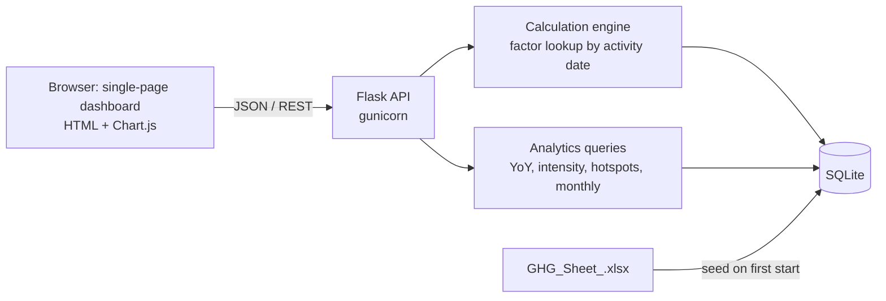

# Carbon Emissions Reporting Platform (GHG Protocol – Scope 1 & 2)

Prototype for the Exascale Deeptech & AI assignment. Activity data × emission factor = kgCO₂e, driven by versioned master data.


## Run it
**Without Docker** (Python 3.10+)
```bash
pip install flask openpyxl
python app.py        # http://localhost:8000
```
(On Linux/macOS you can also use `pip install -r requirements.txt`. That file includes `gunicorn`, which does not run on Windows.)

**Docker**
```bash
docker build -t ghg-platform .
docker run --rm -p 8000:8000 ghg-platform
# open http://localhost:8000
```
The SQLite DB is created and seeded automatically on first start (from `data/GHG_Sheet_.xlsx`). Delete `ghg.db` / the container to reseed. The dashboard loads Chart.js and the font from a CDN, so the browser needs internet access.

## Walkthrough notebook
`Project_Walkthrough.ipynb` explains the system step by step (tables, versioned factors, historical accuracy, override and audit log, analytics). Open it with Jupyter Lab **from the project folder** (needs `pandas` and `matplotlib`).

## Architecture

Stack: Python 3 / Flask / SQLite (stdlib `sqlite3`), vanilla JS + Chart.js, Docker. SQLite keeps the prototype zero-config; the schema is plain SQL and ports to PostgreSQL unchanged apart from date functions.

## Data model
| Table | Purpose |
|---|---|
| `emission_factors` | Versioned factors: `scope, activity, unit, kgco2e_per_unit, source, valid_from, valid_to` (`valid_to` NULL = current). Unique on (scope, activity, valid_from). |
| `emission_records` | One row per activity: quantity, `activity_date`, `factor_id` + `factor_used` (snapshot), `calculated_kgco2e`, `final_kgco2e` (differs only after override), `is_overridden`, `origin` (`sheet` / `sample` / `user`). |
| `audit_log` | Every manual override: record, old value, new value, mandatory reason, user, timestamp. |
| `business_metrics` | `date, metric_name, value, unit, aggregation` (`sum` for production, `avg` for headcount). |

**Historical accuracy:** `find_factor()` selects the version whose `[valid_from, valid_to]` window contains the *activity date*, never simply the latest one. Seeded factors have three versions each (2023 expired, 2024 expired, 2025+ current), so 2024 and 2025 records visibly use different factors. Adding a new version via `POST /api/factors` automatically closes the previously open one.

## API
| Method & path | Description |
|---|---|
| `POST /api/emissions` | Create a Scope 1 or 2 record `{scope, activity, quantity, activity_date}`; 422 if no factor is valid on that date |
| `GET /api/emissions?scope=&year=&origin=&limit=` | List records |
| `POST /api/emissions/<id>/override` | `{value_kgco2e, reason, user}` – replaces final value, writes audit entry (reason required) |
| `GET /api/audit-log?record_id=` | Override history |
| `GET/POST /api/factors` | List (filter by scope/activity/date) or add a factor version |
| `GET/POST /api/business-metrics` | List or upsert a metric |
| `GET /api/analytics/yoy?year=2025` | Totals by scope for the year and previous year |
| `GET /api/analytics/intensity?year=2025` (or `start`,`end`, `metric`) | kgCO₂e per unit of production (default metric: Tons of Steel Produced) |
| `GET /api/analytics/hotspots?year=2025&top_n=8&scope=` | Emissions by source with % share, tail grouped as "Other sources" |
| `GET /api/analytics/monthly?year=2025` | Monthly totals by scope |
| `GET /api/meta` | Activities, years and metrics for the UI |

Analytics always use `final_kgco2e`, so overrides flow into every chart.

## Dashboard
Stacked bar (YoY by scope), donut (hotspots), KPI card (emission intensity with change vs previous year), line chart (monthly trend), plus forms for emission records and business metrics, a records table with override action, and the audit log.

## Data notes and assumptions (please read)
- The spreadsheet has no year column, so it is treated as **2024** (Scope 3 sheet is dated 2024). Scope 1 has Q1–Q2, Scope 2 has Q1–Q3. Quarterly quantities are split evenly over three months to allow monthly trends.
- Missing months of 2024 and all of 2025, the 2023/2025 factor versions, and all `business_metrics` are **generated sample data** (fixed random seed, flagged `origin='sample'` or "SAMPLE" in `source`). They exist so YoY, intensity and historical accuracy can be demonstrated.
- Sheet quirks kept as-is: many Scope 1 factor units (e.g. `tCO2/KL`) don't match the material's quantity unit; the factor is applied to the quantity as given. Scope 2 factors (e.g. 0.8 "tCO₂/kWh") look like per-MWh values. Quantities are very large, so absolute totals and intensity are not realistic. A production system would validate units against a master unit table.
- Scope 3 sheet is not loaded (assignment focuses on Scope 1 & 2).

## Not included
Automated tests, authentication (override `user` is a free-text field), and hosted deployment.

## Note on testing
The app was tested locally with Python (`python app.py`). The Dockerfile is provided
but could not be built on my laptop (Docker Desktop failed to start), so it is untested.

## Author
Gaurav Bisen , Data Science Intern assignment submission for Exascale AI.
