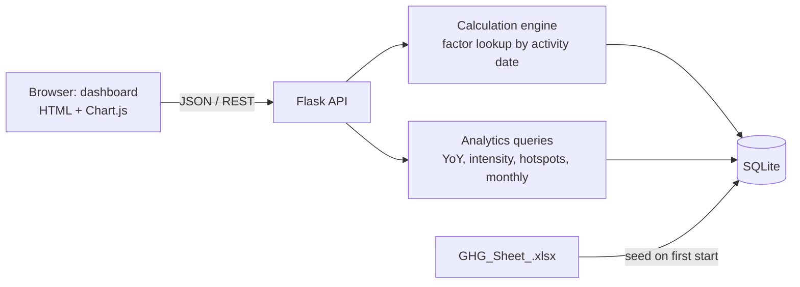

# Carbon Emissions Reporting Platform

A GHG Protocol reporting prototype for a steel plant. Scope 1 (direct) and Scope 2 (purchased energy) emissions are calculated as activity data × emission factor, with factors versioned by validity date. A web dashboard shows year-over-year change, emission intensity and the largest emission sources. Backend: Flask and SQLite.

Submitted by: Gaurav Bisen | Data Developer Intern assignment, Exascale Deeptech & AI


## Quick start

**With Docker**
```
docker build -t ghg-platform .
docker run -p 8000:8000 ghg-platform
```

**Without Docker** (Python 3.10 or newer)
```
pip install flask openpyxl
python app.py
```
Run this from the project folder (the one that contains `app.py`, `data` and `static`).

Then open:
- Dashboard: http://localhost:8000

The database is created and filled from `data/GHG_Sheet_.xlsx` on the first start. The dashboard loads Chart.js from a CDN, so the browser needs internet access.

## Results

| | 2024 | 2025 |
|---|---|---|
| Total emissions (tCO₂e) | 3.40 billion | 3.24 billion |
| Emission intensity (kgCO₂e per tonne of steel) | | about 818,000 |

Total emissions in 2025 are 4.9 % lower than in 2024, and the intensity is 4.3 % lower. Scope 1 makes up almost all of the total; Scope 2 is a very small share. The absolute values are very large because the quantities in the provided spreadsheet are very large (see *Design decisions*).

## What is in the repository

| Path | Content |
|---|---|
| `Project_Walkthrough.ipynb` | Walkthrough of the tables, factor versions, override with audit log and the analytics |
| `app.py` | Flask application: schema, seeding, calculation engine, API |
| `static/index.html` | Dashboard (HTML, CSS, JavaScript with Chart.js) |
| `data/` | Provided spreadsheet `GHG_Sheet_.xlsx` |
| `Dockerfile`, `requirements.txt` | Container and dependencies |
| `dashboard.png` | Dashboard screenshot |

The notebook imports `app.py`, so run it from the project folder.

## API

| Endpoint | Description |
|---|---|
| `POST /api/emissions` | Create a Scope 1 or 2 record: `scope`, `activity`, `quantity`, `activity_date`. Returns 422 if no factor is valid on that date. |
| `GET /api/emissions?scope=1&year=2025&limit=20` | List records. Filters: `scope`, `year`, `origin`, `limit`. |
| `POST /api/emissions/<id>/override` | Override a value: `value_kgco2e`, `reason`, `user`. The reason is mandatory. |
| `GET /api/audit-log?record_id=1` | Override history |
| `GET /api/factors`, `POST /api/factors` | List factors, or add a new factor version |
| `GET /api/business-metrics`, `POST /api/business-metrics` | List metrics, or add or update one |
| `GET /api/analytics/yoy?year=2025` | Totals by scope for the year and the previous year |
| `GET /api/analytics/intensity?year=2025` | kgCO₂e per unit of production. Also accepts `start`, `end` and `metric`. |
| `GET /api/analytics/hotspots?year=2025&top_n=8` | Emissions by source with percentage share |
| `GET /api/analytics/monthly?year=2025` | Monthly totals by scope |
| `GET /api/meta` | Activities, years and metrics for the dashboard |
| `GET /api/health` | Health check |

## Design decisions

- **Architecture.** The browser calls a Flask API. The API has a calculation engine (factor lookup by activity date) and analytics queries, both on one SQLite database that is filled from the spreadsheet on the first start.



- **Data model.** Four tables:

| Table | Content |
|---|---|
| `emission_factors` | Versioned factors: scope, activity, unit, `kgco2e_per_unit`, source, `valid_from`, `valid_to` (empty means current) |
| `emission_records` | One row per activity: quantity, `activity_date`, factor used, `calculated_kgco2e`, `final_kgco2e`, `is_overridden`, `origin` (`sheet`, `sample` or `user`) |
| `audit_log` | Every override: record, old value, new value, reason, user, time |
| `business_metrics` | Date, metric name, value, unit and aggregation (`sum` for production, `avg` for headcount) |

- **Historical accuracy.** The factor is chosen by the date of the activity: the version whose `valid_from` to `valid_to` window contains that date. Each factor has three versions (2023 and 2024 expired, 2025 onward current). The same 100 units of acetylene give different results for 2023, 2024 and 2025 dates, and a date without a valid factor is rejected. Adding a new version closes the previous one.
- **Factor stored in the record.** Each record keeps the id and the value of the factor it was calculated with, so a later change of the factor table cannot change a past result.
- **Overrides.** An override replaces `final_kgco2e` but keeps `calculated_kgco2e`. The old value, the new value and the reason go to `audit_log`. All analytics use `final_kgco2e`, so an override appears in every chart.
- **Intensity.** Production is summed over the period and headcount is averaged, so the same table gives kgCO₂e per tonne and kgCO₂e per employee.
- **Data issues found.** The spreadsheet has no year, so it is treated as 2024. Scope 1 covers Q1 and Q2 and Scope 2 covers Q1 to Q3; quarterly quantities are split evenly over three months. Some Scope 1 factor units do not match the unit of the quantity (for example `tCO2/KL` for tonnes), and the Scope 2 factors look like per-MWh values. The sheet is used as provided.
- **Sample data.** Missing months of 2024, all of 2025, the 2023 and 2025 factor versions and all business metrics are generated, and marked `sample` in the database. They exist so that year-over-year, intensity and historical accuracy can be shown.
- **Scope 3.** The Scope 3 sheet is not loaded, because the brief asks to focus on Scope 1 and 2.

## Limitations

- Most of the data is sample data, so the figures show how the system works and are not a real footprint. The quantities in the sheet are very large, so the absolute totals and the intensity are not realistic.
- There is no login. The user name of an override is a free-text field.
- No automated tests. The calculation, overrides and analytics were checked by calling the API, and the Docker image was built and run in GitHub Codespaces.
- SQLite with one worker is enough for a prototype, not for many users at the same time.
