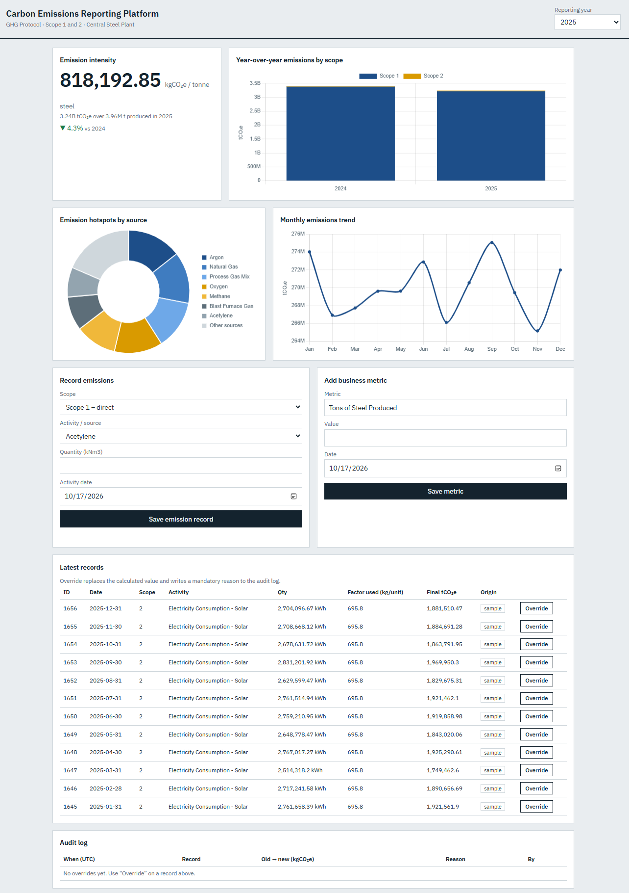
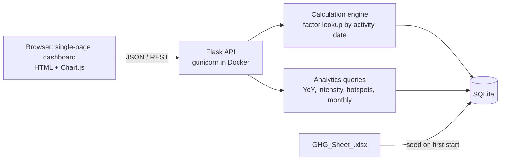

# Carbon Emissions Reporting Platform

A GHG Protocol reporting prototype for a steel plant. It records Scope 1 (direct) and Scope 2 (purchased energy) emissions as activity data × emission factor, keeps the factors versioned by validity date, and reports year-over-year change, emission intensity and the largest emission sources on a web dashboard.

Submitted by: Gaurav Bisen | Data Developer Intern assignment, Exascale Deeptech & AI



## Quick start

**With Docker**
```
docker build -t ghg-platform .
docker run -p 8000:8000 ghg-platform
```

**Without Docker** (Python 3.10 or newer)
```
pip install flask openpyxl
python app.py
```
Run this from the project folder (the one that contains `app.py`, `data` and `static`).

Then open the dashboard at http://localhost:8000.

The database (SQLite) is created and filled from `data/GHG_Sheet_.xlsx` on the first start. Delete `ghg.db` (or the container) to start from scratch. The dashboard loads Chart.js and a font from a CDN, so the browser needs internet access.

## Results

The dashboard shows four views for the selected reporting year:

| View | What it shows |
|---|---|
| Emission intensity (KPI card) | kgCO₂e per tonne of steel, with the change against the previous year |
| Year-over-year (stacked bar) | Total emissions of the selected and previous year, split into Scope 1 and Scope 2 |
| Emission hotspots (donut) | Share of each emission source, top 7 plus "Other sources" |
| Monthly trend (line) | Total emissions per month of the selected year |

For 2025 against 2024 the sample data gives about 3.24 billion tCO₂e against 3.40 billion tCO₂e (a 4.9 % decrease). These absolute values are very large because the quantities in the provided spreadsheet are very large; see *Data notes*.

## What is in the repository

| Path | Content |
|---|---|
| `app.py` | Flask backend: schema, seeding, calculation engine, API |
| `static/index.html` | Dashboard (HTML, CSS, JavaScript with Chart.js) |
| `data/GHG_Sheet_.xlsx` | Provided spreadsheet, used to fill the database |
| `Project_Walkthrough.ipynb` | Step-by-step walkthrough of the tables, factor versions, override and analytics |
| `Dockerfile`, `requirements.txt` | Container and dependencies |
| `dashboard.png` | Dashboard screenshot |

The notebook imports `app.py`, so open Jupyter from the project folder.

## Architecture



Stack: Python, Flask, SQLite (standard library `sqlite3`), plain JavaScript with Chart.js, Docker. SQLite keeps the prototype free of setup; the schema is plain SQL and would move to PostgreSQL with little change.

## Data model

| Table | Content |
|---|---|
| `emission_factors` | Versioned factors: scope, activity, unit, `kgco2e_per_unit`, source, `valid_from`, `valid_to` (empty means current). Unique per scope, activity and `valid_from`. |
| `emission_records` | One row per activity: quantity, `activity_date`, the factor used (`factor_id` and a copy of its value), `calculated_kgco2e`, `final_kgco2e`, `is_overridden`, `origin` (`sheet`, `sample` or `user`). |
| `audit_log` | Every manual override: record, old value, new value, reason, user, time. |
| `business_metrics` | Date, metric name, value, unit and aggregation (`sum` for production, `avg` for headcount). |

**Historical accuracy.** The factor is chosen by the date of the activity: the version whose `valid_from` to `valid_to` window contains that date. The latest factor is never applied to old activity. Each factor has three versions in the seed data (2023 and 2024 expired, 2025 onward current). Adding a new version through the API closes the previously open one automatically.

**Overrides.** An override replaces `final_kgco2e` but keeps `calculated_kgco2e`. A reason is mandatory, and the old and new values are written to `audit_log`. All analytics use `final_kgco2e`, so an override shows up in every chart.

## API

| Endpoint | Description |
|---|---|
| `POST /api/emissions` | Create a Scope 1 or Scope 2 record: `scope`, `activity`, `quantity`, `activity_date`. Returns 422 if no factor is valid on that date. |
| `GET /api/emissions` | List records. Filters: `scope`, `year`, `origin`, `limit`. |
| `POST /api/emissions/<id>/override` | Override a value: `value_kgco2e`, `reason`, `user`. |
| `GET /api/audit-log` | Override history. Filter: `record_id`. |
| `GET` / `POST /api/factors` | List factors (filter by scope, activity, date) or add a factor version. |
| `GET` / `POST /api/business-metrics` | List metrics or add or update one. |
| `GET /api/analytics/yoy?year=2025` | Totals by scope for the year and the previous year. |
| `GET /api/analytics/intensity?year=2025` | kgCO₂e per unit of production. Also accepts `start`, `end` and `metric`; the default metric is Tons of Steel Produced. |
| `GET /api/analytics/hotspots?year=2025&top_n=8` | Emissions by source with percentage share. |
| `GET /api/analytics/monthly?year=2025` | Monthly totals by scope. |
| `GET /api/meta` | Activities, available years and metrics for the dashboard. |
| `GET /api/health` | Health check. |

## Design decisions

- **Factor snapshot in each record.** Each record stores the factor id and the factor value it was calculated with, so a later correction of the factor table cannot change a past result.
- **Overrides keep the original.** The calculated value stays in the record, so an override can always be traced and compared.
- **Intensity from business metrics.** Production is summed over the period and headcount is averaged, so one table supports both kgCO₂e per tonne and kgCO₂e per employee.
- **Scope 3.** The Scope 3 sheet is not loaded, because the brief asks to focus on Scope 1 and 2.

## Data notes

- The spreadsheet has no year column, so it is treated as 2024 (the Scope 3 sheet is dated 2024). Scope 1 has Q1 and Q2, Scope 2 has Q1 to Q3. Quarterly quantities are split evenly over three months to allow a monthly trend.
- Missing months of 2024, all of 2025, the 2023 and 2025 factor versions and all business metrics are generated sample data. They are marked `origin = 'sample'` or "SAMPLE" in `source`, and exist so that year-over-year, intensity and historical accuracy can be demonstrated.
- Some Scope 1 factor units in the sheet do not match the unit of the quantity (for example `tCO2/KL` for a quantity in tonnes). The factor is applied to the quantity as given. The Scope 2 factors (for example 0.8 per kWh) look like per-MWh values. The sheet is used as provided; a production system should validate units against a master unit table.
- Because of the large quantities in the sheet, absolute totals and the intensity value (about 818,000 kgCO₂e per tonne for 2025) are not realistic.
- Scope 2 is a very small share of the total in this data, so it is barely visible in the stacked bar.

## Testing

Checked against the provided spreadsheet and by calling the API:

- The Scope 1 total in the database equals quantity × factor summed over the spreadsheet rows.
- The same quantity gives different results for activity dates in 2023, 2024 and 2025 (for acetylene 3,246.9, 3,122.0 and 3,059.6 kgCO₂e per kNm³), and a date without a valid factor is rejected.
- Adding a factor version closes the previous one. An override without a reason is rejected, and an override with a reason is written to the audit log.
- The year-over-year total equals the sum in the database, including overrides.

The app was run locally with Python. The Docker image was also built and run in GitHub Codespaces; the API answered on `/api/health` and the dashboard loaded from the container. There is no automated test suite.

## Limitations

- Most of the data is sample data (see *Data notes*), so the figures show how the system works, not a real footprint.
- There is no login. The user name of an override is a free-text field.
- SQLite and a single worker are enough for a prototype, not for many concurrent users.
- Only Scope 1 and Scope 2 are covered.
